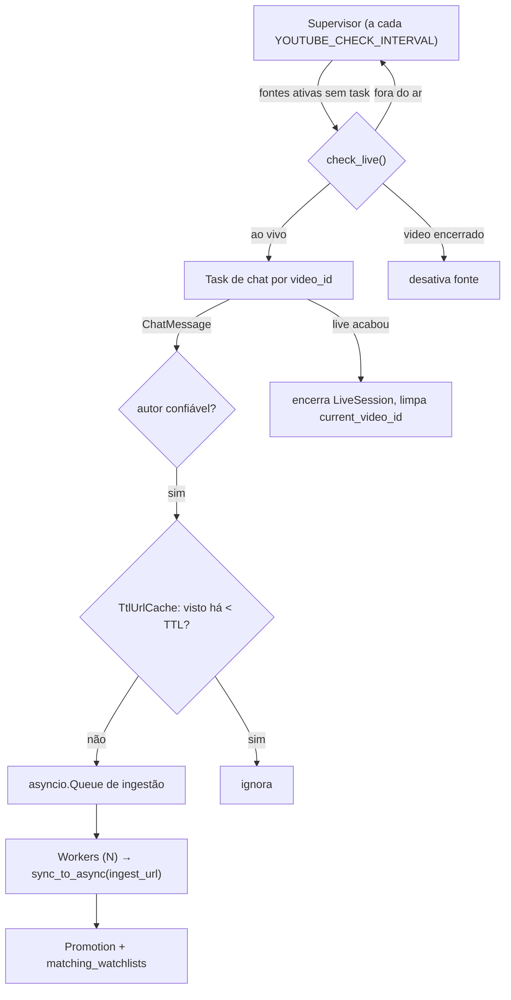

# Arquitetura — Monitor de Lives do YouTube

> **Documento de handoff.** Descreve o desenho completo do monitor de chat de
> lives do YouTube e o estado de cada fase. Quem continuar o trabalho deve
> ler este arquivo inteiro, conferir a seção [Status das fases](#status-das-fases)
> e atualizar os checkboxes ao concluir cada etapa.

## 1. Objetivo

1. Usuários (admins do servidor Discord) cadastram **fontes** do YouTube:
   - **Canal** de loja (`@kabum`, `UC...`, URL do canal): monitorado para sempre;
     sempre que estiver ao vivo, o chat é lido.
   - **Live específica** (`watch?v=`, `youtu.be/`, `/live/ID`): lida uma vez,
     até a live acabar; depois a fonte é desativada.
2. Um processo de longa duração (`python manage.py run_youtube_monitor`):
   - verifica periodicamente quais canais estão ao vivo;
   - conecta no chat de cada live ativa e recebe mensagens em tempo real;
   - extrai os links das mensagens (de autores confiáveis);
   - ignora links já vistos há pouco tempo (lojas fazem spam do mesmo link);
   - envia os links novos para a ingestão existente
     (`scrapers.ingestion.ingest_url`), que raspa o produto, salva a
     `Promotion` e aplica as watchlists dos usuários.

## 2. Decisões principais

| Decisão | Escolha | Motivo |
|---|---|---|
| Como ler o chat | **API interna "innertube"** do site (`/live_chat` + `POST /youtubei/v1/live_chat/get_live_chat`) via `httpx.AsyncClient` | Sem API key e sem cota. A YouTube Data API v3 custa ~5 unidades por poll (10k/dia → ~3 h de uma única live) e `search.list` (detectar live) custa 100. |
| Biblioteca pronta (pytchat / chat-downloader) | **Não usar** | pytchat está arquivado; chat-downloader é síncrono (requests). Implementação própria tem ~300 linhas, é testável com fixtures e segue o padrão httpx do projeto. |
| Detectar se canal está ao vivo | `GET https://www.youtube.com/<canal>/live` e ler `ytInitialPlayerResponse` | Se ao vivo, a página é o player da live (`videoDetails.isLive == true`, `liveBroadcastDetails.isLiveNow == true`). Se não, o canonical é a página do canal e não há `videoDetails`. Verificado em 2026-11-08 (`@LofiGirl` ao vivo, `@kabum` fora do ar). |
| Concorrência | **Um processo asyncio**: supervisor + 1 task por live + pool de workers de ingestão | Leitura de chat é I/O puro; a ingestão (scraping síncrono + ORM) roda em threads via `sync_to_async(thread_sensitive=False)`. |
| Deduplicação de links | Cache em memória com **TTL** (padrão 180 s), global entre todas as lives | Requisito: não re-raspar um link enviado de novo há poucos minutos. Após o TTL, re-raspar é desejado (preço/estoque podem mudar). A ingestão só re-notifica usuários em queda de preço ou volta ao estoque. |
| Quem pode enviar links válidos | Por padrão só **dono do canal, moderadores e verificados** (`trusted_authors_only=True`, configurável por fonte) | Qualquer espectador pode colar link de loja falsa com JSON-LD forjado. Isso é perigoso quando a boletagem automática existir. |
| Quem cadastra fontes | Apenas IDs do Discord listados em `DISCORD_ADMIN_IDS` no `.env` (validado tanto no bot quanto na API via `IsDiscordAdmin`) + limite `YOUTUBE_MAX_SOURCES` | Fontes são globais (afetam carga do servidor). |
| Onde fica o código | Novo app Django **`lives`** | `scrapers` continua genérico (produto/página). |

## 3. Estrutura de arquivos

```
backend/
  scrapers/
    dedup.py                  # TtlUrlCache (compartilhado com o monitor do Telegram)
  lives/                      # novo app Django (INSTALLED_APPS)
    apps.py
    models.py                 # YouTubeSource, LiveSession
    migrations/
    serializers.py            # YouTubeSourceSerializer (valida/normaliza a entrada)
    views.py, urls.py         # /api/youtube/sources/ (token de serviço do bot)
    youtube/
      __init__.py
      parsing.py              # funções PURAS: entrada do usuário, HTML, chat JSON
      client.py               # YouTubeClient (async): check_live(), LiveChatReader
    monitor.py                # YouTubeLiveMonitor (supervisor + tasks + workers)
    management/commands/
      youtube_sources.py      # add | list | remove | enable | disable
      run_youtube_monitor.py  # processo de longa duração
    test_lives.py
discord-bot/
  cogs/youtube.py             # /youtube add | list | remove
docs/
  arquitetura-youtube-live.md # este arquivo
```

## 4. Modelo de dados (`lives/models.py`)

```python
class YouTubeSource(models.Model):
    class Kind(models.TextChoices):
        CHANNEL = "channel", "Canal"
        VIDEO = "video", "Live específica"

    kind = CharField(choices=Kind)
    identifier = CharField(max_length=120)   # "@kabum" | "UC…" | "c/nome" | video_id (11 chars)
    label = CharField(max_length=120, blank=True)      # nome do canal (preenchido ao detectar live)
    enabled = BooleanField(default=True)
    trusted_authors_only = BooleanField(default=True)
    added_by = CharField(max_length=32, blank=True)    # discord_id de quem cadastrou
    created_at = DateTimeField(auto_now_add=True)
    last_checked_at = DateTimeField(null=True)
    last_live_at = DateTimeField(null=True)
    current_video_id = CharField(max_length=16, blank=True)  # vazio = fora do ar
    note = CharField(max_length=200, blank=True)        # ex.: "live encerrada", erro de chat
    # unique_together (kind, identifier)

    live_url  -> property: URL verificada pelo supervisor
        channel: https://www.youtube.com/<@handle | channel/UC… | c/nome>/live
        video:   https://www.youtube.com/watch?v=<id>

class LiveSession(models.Model):
    source = FK(YouTubeSource, CASCADE, related_name="sessions")
    video_id = CharField(max_length=16)
    title = CharField(max_length=300, blank=True)
    started_at = DateTimeField(auto_now_add=True)
    ended_at = DateTimeField(null=True)
    messages_seen = PositiveIntegerField(default=0)
    links_seen = PositiveIntegerField(default=0)
    links_ingested = PositiveIntegerField(default=0)   # passaram pelo cache TTL
    promotions_matched = PositiveIntegerField(default=0)
```

`LiveSession` é histórico/telemetria (útil em `/youtube list` e para depurar).
Não precisa de purge agora; se crescer, apagar sessões encerradas > 30 dias.

## 5. Entrada do usuário → fonte (`parsing.parse_source_input`)

| Entrada | kind | identifier |
|---|---|---|
| `@kabum`, `youtube.com/@kabum`, `…/@kabum/live`, `…/@kabum/videos` | channel | `@kabum` |
| `UCxxxxxxxxxxxxxxxxxxxxxx`, `…/channel/UC…` | channel | `UC…` |
| `…/c/Nome`, `…/user/Nome` | channel | `c/Nome` / `user/Nome` |
| `…/watch?v=ID`, `youtu.be/ID`, `…/live/ID`, `ID` (11 chars) | video | `ID` |

Qualquer outra coisa → `ValueError` com mensagem amigável. Só hosts
`youtube.com`, `www.youtube.com`, `m.youtube.com`, `youtu.be`.

## 6. Protocolo do YouTube (innertube) — referência

Headers: User-Agent de navegador, `Accept-Language: pt-BR`, cookie
`SOCS=CAI` (evita a tela de consentimento da UE).

### 6.1 Detectar live
`GET {source.live_url}` → no HTML, decodificar o JSON após
`ytInitialPlayerResponse = ` com `json.JSONDecoder().raw_decode` (não usar
regex não-gulosa para JSON: quebra em `};` dentro de strings).

```
videoDetails.videoId / title / author / isLive / isUpcoming
microformat.playerMicroformatRenderer.liveBroadcastDetails.isLiveNow
```
`is_live = videoDetails.isLive is True and not isUpcoming`. Sem `videoDetails` → fora do ar.
Para fonte `video`: se não está ao vivo e não é `isUpcoming` → live encerrada/VOD → desativar fonte.

### 6.2 Abrir o chat
`GET https://www.youtube.com/live_chat?v={video_id}&is_popout=1`
- `ytcfg.set({...})` → `INNERTUBE_API_KEY`, `INNERTUBE_CONTEXT` (raw_decode do objeto).
- `ytInitialData` → `contents.liveChatRenderer`:
  - `actions[]`: mensagens iniciais (histórico recente — processar também);
  - `continuations[0].<tipo>ContinuationData.continuation` (tipos: `invalidation`, `timed`, `reload`);
  - **preferir "Chat ao vivo" (todas as mensagens)** em vez de "Principais":
    `header.liveChatHeaderRenderer.viewSelector.sortFilterSubMenuRenderer.subMenuItems[-1].continuation.reloadContinuationData.continuation`.
- Sem `liveChatRenderer` → chat desativado/indisponível → `ChatUnavailable`.

### 6.3 Polling
`POST https://www.youtube.com/youtubei/v1/live_chat/get_live_chat?prettyPrint=false`
body `{"context": INNERTUBE_CONTEXT, "continuation": token}`
→ `continuationContents.liveChatContinuation`:
- `actions[]` novas mensagens;
- `continuations[0].*ContinuationData.{continuation, timeoutMs}` → próximo token e espera
  (limitar `timeoutMs` a [3 s, 15 s]).
- **Sem `continuationContents` ou sem `continuations` → live acabou.**
- HTTP 4xx/5xx/rede → backoff exponencial (2, 4, 8… até 60 s); após 5 falhas seguidas, reabrir o chat (6.2); após 3 reaberturas, encerrar a sessão com `note`.

### 6.4 Formato das ações (o que extrair)
```
addChatItemAction.item.liveChatTextMessageRenderer
addChatItemAction.item.liveChatPaidMessageRenderer          (Super Chat)
addBannerToLiveChatCommand.bannerRenderer.liveChatBannerRenderer.contents.liveChatTextMessageRenderer  (mensagem FIXADA — lojas fixam links)
replaceChatItemAction.replacementItem.<mesmos renderers>
```
Em cada renderer:
- `id`, `authorName.simpleText`, `authorExternalChannelId`
- `authorBadges[].liveChatAuthorBadgeRenderer.icon.iconType` ∈ `OWNER | MODERATOR | VERIFIED` (membros têm `customThumbnail`, não contam como confiáveis)
- `message.runs[]`: `{text}` | `{text, navigationEndpoint.urlEndpoint.url}` | `{emoji}`
  - O `text` de um link pode vir **truncado** ("kabum.com.br/produto/12…"). Usar o `urlEndpoint.url`.
  - `urlEndpoint.url` costuma ser `https://www.youtube.com/redirect?…&q=<url real codificada>` → desembrulhar o `q`.
  - Também rodar `scrapers.links.extract_urls` no texto concatenado (links não clicáveis).
- Mensagens do próprio dono do canal: `iconType == OWNER`.
- Deduplicar por `id` da mensagem dentro da sessão (banner fixado reaparece).

Modelo interno: `ChatMessage(id, author, author_channel_id, badges: frozenset[str], text, links: list[str], pinned: bool)`; `is_trusted = bool(badges & {"OWNER","MODERATOR","VERIFIED"})`.

## 7. Monitor (`lives/monitor.py`)



Regras:
- Tasks ativas indexadas por **`video_id`** (canal + live específica do mesmo vídeo não abrem 2 leitores).
- Verificação de canais com `asyncio.Semaphore(3)`, para não martelar o YouTube.
- Enquanto uma task está ativa, o supervisor **não** verifica aquela fonte; a task re-verifica
  `check_live()` a cada `YOUTUBE_RECHECK_LIVE_SECONDS` (300 s) como segunda prova de fim.
- Fila de ingestão com `maxsize` (500); se cheia, descarta com warning (não bloquear o chat).
- Workers: cada um com seu `JsonLdScraper`; `close_old_connections()` antes/depois de cada ingestão.
- Contadores da `LiveSession` acumulados em memória e gravados a cada ~30 s e no fim.
- Origem gravada na promoção: `youtube:<label ou identifier>` (máx. 120 chars).
- Shutdown (Ctrl+C / SIGTERM): cancelar tasks, fechar sessões abertas com `ended_at`, fechar clientes.
- Ao iniciar, fechar `LiveSession`s órfãs (`ended_at IS NULL`) de execuções anteriores.

## 8. Deduplicação (`scrapers/dedup.py`)

```python
class TtlUrlCache:
    def __init__(self, ttl_seconds: float, max_size: int = 10_000, clock=time.monotonic): ...
    def should_process(self, url: str) -> bool:
        """True se a URL (normalizada com clean_url) não foi vista nos últimos ttl s; registra o acesso."""
```
- Chave = `scrapers.links.clean_url(url)`.
- Armazenamento `OrderedDict[url, timestamp]`; poda das entradas expiradas e do excesso (LRU).
- `clock` injetável para testes.
- O monitor do Telegram passa a usar o mesmo cache (TTL `TELEGRAM_LINK_TTL_SECONDS`), substituindo `_RecentUrls`.

## 9. Configuração (`settings.py` / `.env`)

| Variável | Padrão | Uso |
|---|---|---|
| `YOUTUBE_CHECK_INTERVAL` | 120 | s entre verificações de canais |
| `YOUTUBE_RECHECK_LIVE_SECONDS` | 300 | re-verificação de live ativa |
| `YOUTUBE_LINK_TTL_SECONDS` | 180 | janela de deduplicação de links |
| `YOUTUBE_INGEST_WORKERS` | 4 | workers de scraping |
| `YOUTUBE_MAX_SOURCES` | 50 | limite de fontes cadastradas |
| `TELEGRAM_LINK_TTL_SECONDS` | 180 | dedup do Telegram |

## 10. Interfaces de gerenciamento

**CLI**
```bash
python manage.py youtube_sources add @kabum [--any-author]
python manage.py youtube_sources add https://www.youtube.com/watch?v=XXXXXXXXXXX
python manage.py youtube_sources list
python manage.py youtube_sources remove <id>
python manage.py youtube_sources disable|enable <id>
python manage.py run_youtube_monitor
```

**API** (header `X-Bot-Token`; `X-Discord-User-ID` grava `added_by`)
```
GET    /api/youtube/sources/        lista (inclui current_video_id, last_live_at, label, note)
POST   /api/youtube/sources/        {"source": "<url|@handle|id>", "trusted_authors_only": true}
DELETE /api/youtube/sources/<id>/
```
- POST com fonte já existente → 200 reativando (`enabled=True`), não duplica.
- Limite `YOUTUBE_MAX_SOURCES` → 400.

**Discord** (`cogs/youtube.py`, grupo `/youtube`, restrito a `DISCORD_ADMIN_IDS` do `.env` via `interaction_check` e `IsDiscordAdmin` na API)
```
/youtube add <canal_ou_live> [qualquer_autor: bool]
/youtube list         (🔴 ao vivo agora / ⚪ fora do ar / ⏸ desativada)
/youtube remove <id>
```
> Nota: `discord-bot/bot.py` usava `discord.Client` + `add_cog` (só existe em
> `commands.Bot`). Corrigido para `commands.Bot` junto desta fase.

## 11. Testes

Sem rede: tudo com fixtures sintéticas que imitam o JSON real (seção 6).
- `parsing`: entradas do usuário; detecção ao vivo / fora / upcoming; ytcfg/ytInitialData;
  ações de chat (texto, link com redirect, link truncado, banner fixado, badges, Super Chat).
- `client`: `httpx.MockTransport` simulando página de chat + 2 polls + fim (sem continuation).
- `dedup`: relógio falso (dentro/fora do TTL, max_size).
- `monitor`: `handle_messages` filtra autores, dedup e enfileira; worker chama ingestão (FakeScraper);
  supervisor com `check_live` falso abre/fecha `LiveSession` e desativa fonte `video` encerrada.
- API e comando `youtube_sources`.
- Teste manual: `python manage.py run_youtube_monitor` com uma live real (ex.: `@LofiGirl`, 24/7 — sem links, serve para validar conexão/polling).

Rodar: `cd backend; .venv\Scripts\python.exe manage.py test` (ver TESTES.txt).

## 12. Riscos conhecidos

- Innertube não é API pública: o formato pode mudar. Toda a interpretação fica em
  `lives/youtube/parsing.py` (um único lugar para corrigir) e os testes fixam o formato esperado.
- Rate limit/bloqueio por IP se houver muitas fontes: intervalo + semáforo + backoff.
- Links de afiliado/encurtadores são resolvidos pelo `fetch.py` (já bloqueia redes privadas).

## Status das fases

- [x] F1 — Documento de arquitetura (este arquivo)
- [x] F2 — `scrapers/dedup.py` (`TtlUrlCache`) + migrar Telegram + testes
- [x] F3 — App `lives`: models, migration, settings, `youtube_sources` + testes
- [x] F4 — `lives/youtube/parsing.py` + testes com fixtures
- [x] F5 — `lives/youtube/client.py` (check_live, LiveChatReader) + testes MockTransport + teste manual
- [x] F6 — `lives/monitor.py` + `run_youtube_monitor` + testes
- [x] F7 — API REST `/api/youtube/sources/` + testes
- [x] F8 — Discord: `cogs/youtube.py` + correção `bot.py`
- [x] F9 — README, TESTES.txt, `.env.example`

## Notas para quem continuar

- Ambiente: `backend/.venv` (Python 3.13). `uv` pode não estar instalado.
- Arquivos antigos do repo usam CRLF; ao editar, alvos com várias linhas podem não casar — edite linha a linha.
- Em `TestCase`, chamadas a `close_old_connections()` fecham a conexão da transação de teste:
  faça `patch` delas (ver `scrapers/test_scrapers.py::TelegramMonitorTests`).
- Fixtures/sondas reais usadas no desenho: `brain/.../scratch/probe_youtube.py` (não versionado).
